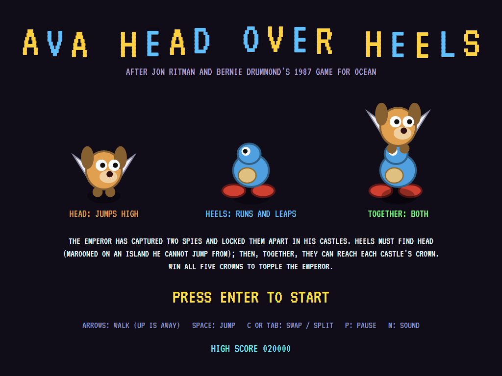
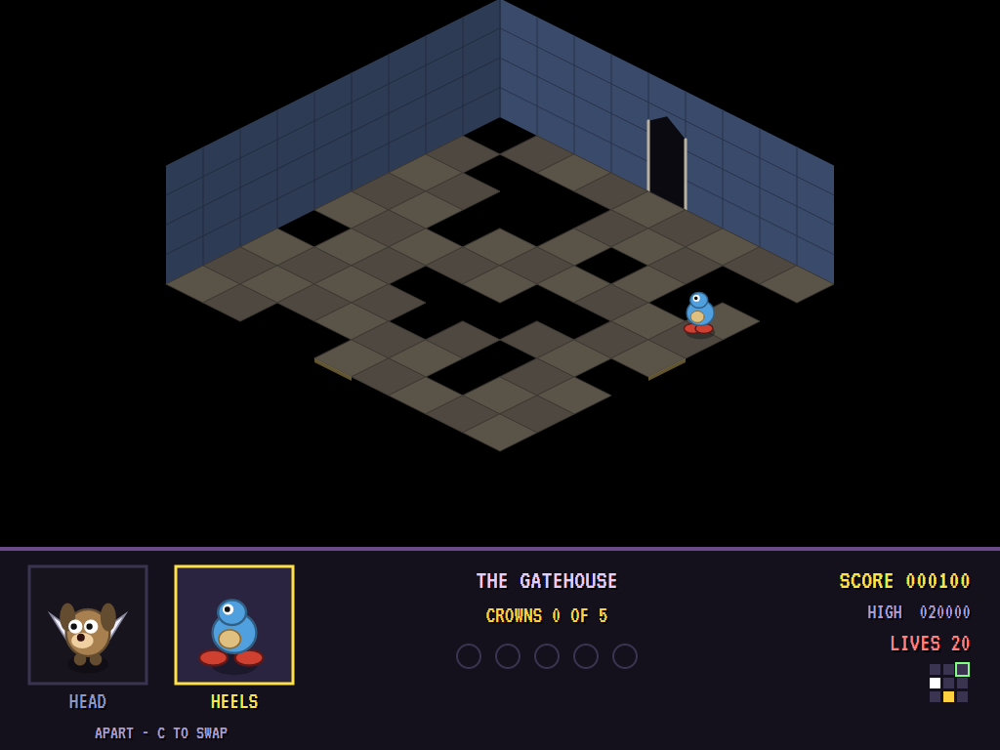
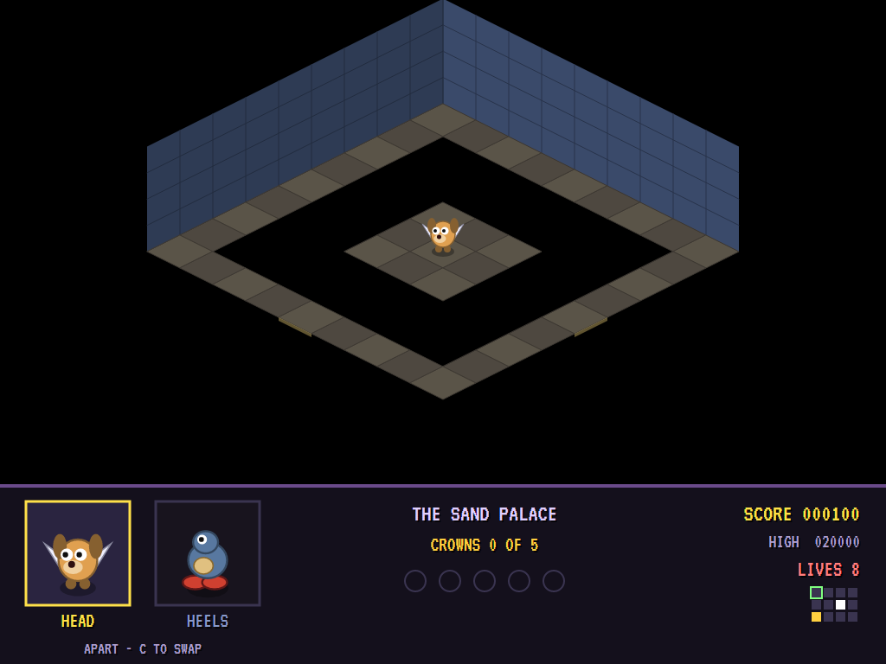
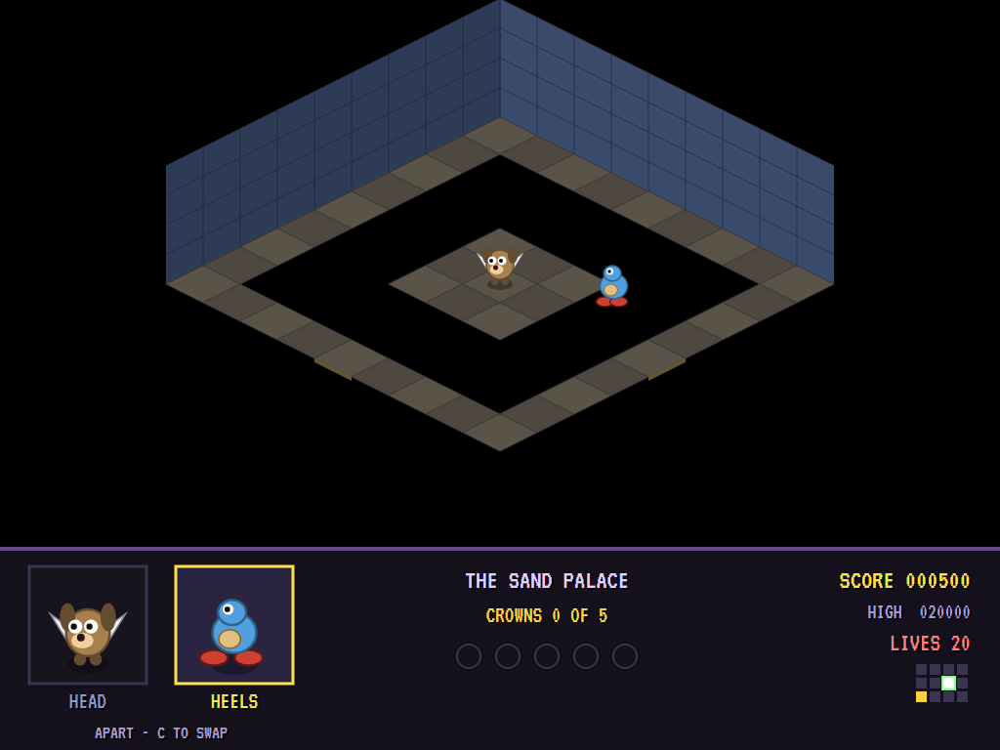
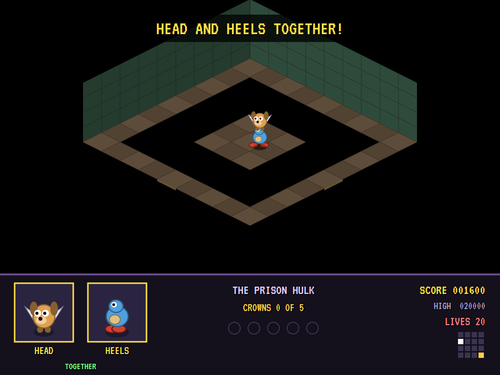
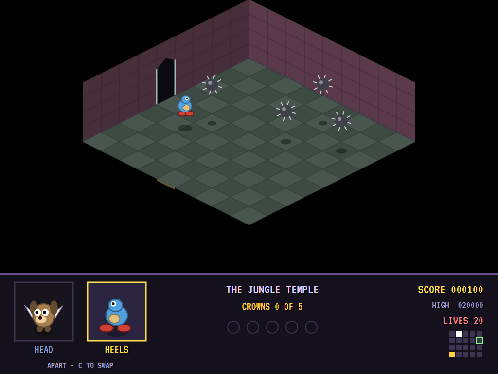
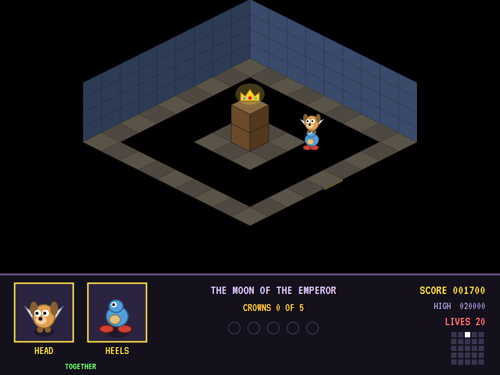
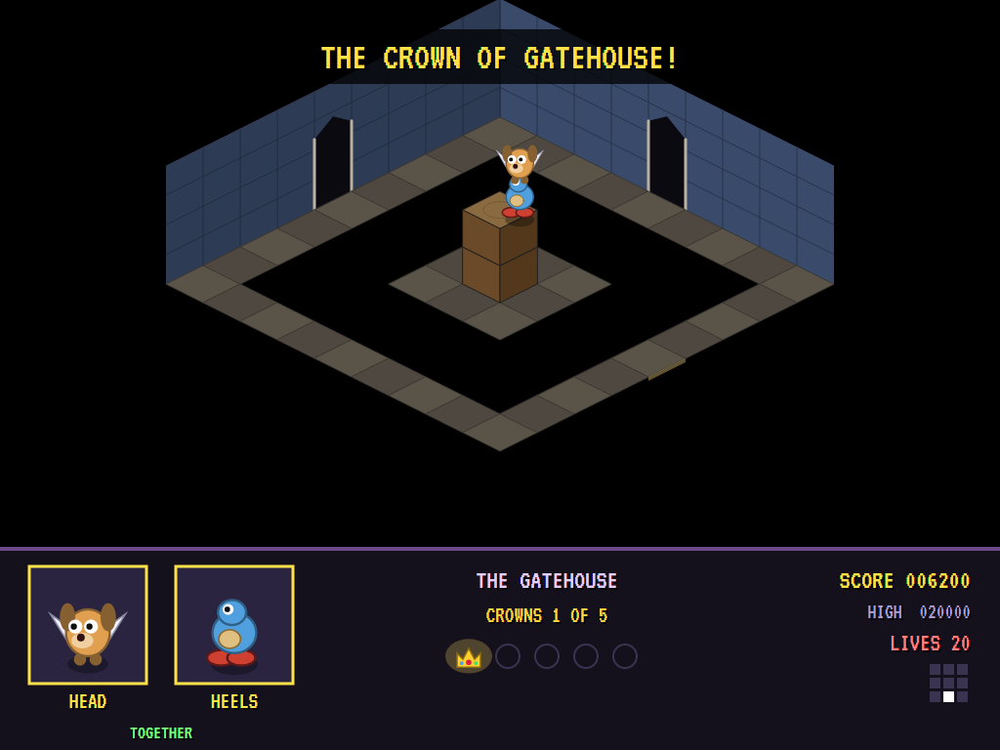
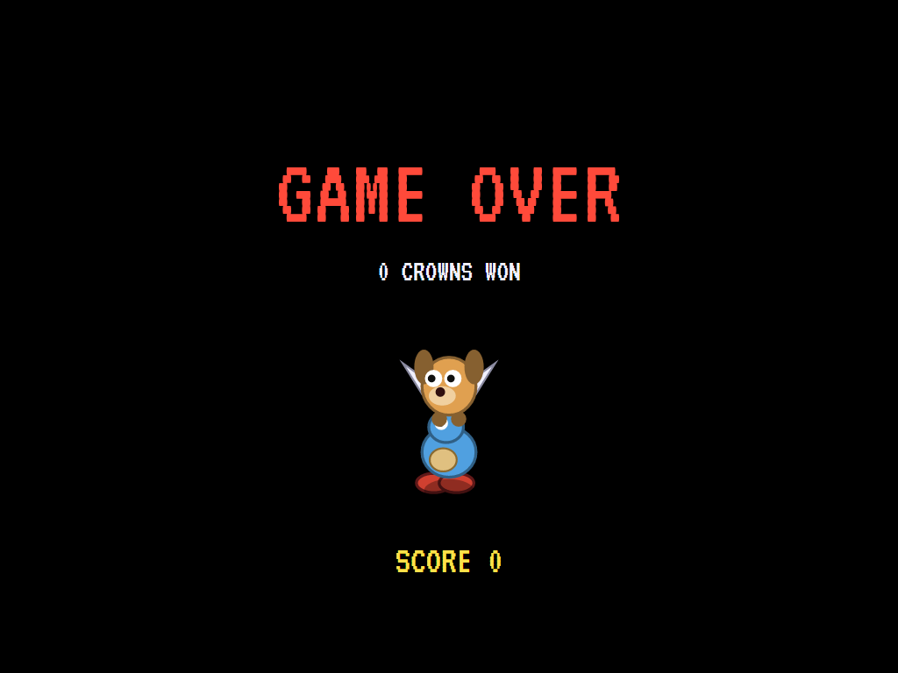
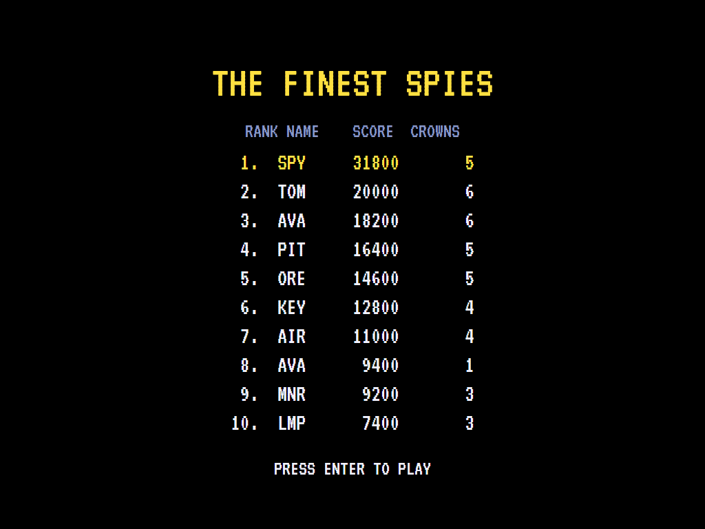

# AVA Head Over Heels

[](https://github.com/Harlock123/AVAHeadOverHeels/actions/workflows/build.yml)

An isometric adventure for two characters, in the style of Jon Ritman and Bernie Drummond's 1987 game **Head
Over Heels**. It's built with .NET 10 and Avalonia UI. The Emperor has captured two spies and locked them apart
in his castles. Head jumps high but walks slowly; Heels runs fast and leaps far but can't jump high. Apart, each
can go where the other can't. Together, Head riding on Heels, they can go anywhere. Find each other, join up,
and win the crown of each of the five castles.

## Features

- **Two characters, one at a time.** Swap between them with a key, wherever each one is; the screen follows.
  Walk one into the other and they join up. Swap again and they come apart.
- **Abilities that matter.** Head jumps onto two blocks; Heels only onto one. Heels leaps a pit two squares
  wide; Head falls in. Joined, they have Heels' legs and Head's spring.
- **Each castle's puzzle.** Head starts marooned on an island, ringed by a pit too wide for him. Heels must
  cross the castle, leap onto the island and join him. The crown sits on a pillar two blocks high on another
  island: only the two together can reach it.
- **Five castles,** from a gatehouse of nine rooms to the Emperor's moon of twenty-five. Each is a maze of
  rooms built from its own seed, with doors on every side. Every room but the islands is proved passable by
  Head, by Heels and by both together, by trying every walk and jump in the game's own physics.
- **Hazards:** spikes, pits, raised walks and steps, pacing guards, bouncing spiked balls.
- **The panel** shows who's on the move, the crowns won, and a plan of the castle with both of them on it.
- **The attract mode** shows the computer player at work. It swaps to Heels, plans a way round the castle
  to Head, leaps onto the island and joins up. Then it takes the two of them to the crown. In each room it
  knows every place it can stand and where every walk and jump takes it, for whoever is on the move. Before
  each move it plays the move out on a copy of the castle, guards and spiked balls and all, and waits for
  its moment.

## Screenshots

| The title | Heels sets out | Head, marooned |
|:---------:|:--------------:|:--------------:|
|  |  |  |
| Apart, and together. | The first room. | On an island he can't jump from. |

| The leap | Together | Spiked balls |
|:--------:|:--------:|:------------:|
|  |  |  |
| Heels jumps the pit. | Head on Heels. | Mind the bounce. |

| The crown | Crowned | Game over |
|:---------:|:-------:|:---------:|
|  |  |  |
| Up onto the pillar. | One castle won. | |



The screenshots are made by the tests, which play the game in a real (headless) window; see
[Tests](#tests).

## Download and run

Ready-to-run builds for Windows, macOS and Linux, on both Intel/AMD and ARM, are on the
[Releases page](https://github.com/Harlock123/AVAHeadOverHeels/releases/tag/latest). **Latest build** is
rebuilt on every push to `main`. Each download is one self-contained executable: no .NET install is
needed.

| Platform | Archive |
|---|---|
| Windows | `AVAHeadOverHeels-win-x64.zip`, `AVAHeadOverHeels-win-x86.zip`, `AVAHeadOverHeels-win-arm64.zip` |
| macOS | `AVAHeadOverHeels-osx-arm64.tar.gz` (Apple silicon), `AVAHeadOverHeels-osx-x64.tar.gz` (Intel) |
| Linux | `AVAHeadOverHeels-linux-x64.tar.gz`, `AVAHeadOverHeels-linux-arm64.tar.gz`, `AVAHeadOverHeels-linux-arm.tar.gz` |

```bash
tar -xzf AVAHeadOverHeels-linux-x64.tar.gz     # or linux-arm64, linux-arm, osx-arm64, osx-x64
./AVAHeadOverHeels
```

On Windows, unzip and run `AVAHeadOverHeels.exe`. On macOS, if Gatekeeper refuses to open it, run
`xattr -d com.apple.quarantine AVAHeadOverHeels` once. Run with `--no-audio` for silence.

**Sound** comes through OpenAL Soft, built in for every platform. In a virtual machine the game
detects it and uses a larger audio buffer, so the sound doesn't break up.

**Gamepads** use SDL2, which is bundled for Windows, macOS and Intel/AMD Linux. ARM Linux builds need it
installed; without it the keyboard still works:

```bash
sudo apt install libsdl2-dev            # Debian / Ubuntu / Raspberry Pi OS
sudo pacman -S --needed sdl2-compat     # Arch / Omarchy
```
## Controls

| Action | Keyboard | Gamepad |
|---|---|---|
| Start | Enter or 1 | Start |
| Walk | Arrows or W/A/S/D (up goes away up the screen) | Left stick / D-pad |
| Jump | Space, Z, X or Ctrl | A or B |
| Swap (or come apart) | C, Tab, Q or Shift | X or Y |
| Pause | P or Esc | Start or Back |
| Sound on/off | M | |
| Screenshot | Ctrl+S (to your Pictures folder) | |

On the high-score table, type your initials, or use up/down and Space, then Enter.

## Tests

```bash
dotnet test AVAHeadOverHeels.slnx
```

The game runs in fixed 60 Hz steps, so it plays the same at any frame rate. Everything that moves lives in
one world that can be copied. The tests check:

- **The castles:** every room reachable, with doors that match on both sides; Head, Heels and the crown in
  three rooms well apart; every other room passable by Head, by Heels and by both; Head unable to leave his
  island, Heels able to reach it, and only the two together able to reach the crown; the same castle every
  time.
- **Two ways of getting about:** Heels faster than Head; Head onto two blocks and Heels only onto one; Heels
  over a pit two wide and Head into it; joining by walking into the other, with Heels' speed and Head's
  spring; splitting, and not joining again until they've been apart; swapping to the other's room; doors;
  spikes, guards and pits; starting again where that one came in.
- **The game:** the crown scored and the next castle; meeting up announced and scored once; the last life
  lost; the demonstration; pause; the keys.

`tests/AVAHeadOverHeels.Tests/PilotProbe.cs` reports how the computer player gets on in each castle, for
tuning (`HOH_PROBE=1`). It wins every crown without losing a life. `HOH_PROBE=lazy` wanders and jumps and
never wins one.

The screenshot tests draw the real screen in a headless window. To refresh the README's pictures:

```bash
HOH_SHOTS=$PWD/Images dotnet test tests/AVAHeadOverHeels.Tests --filter ScreenshotTests
```

## Building

```bash
dotnet build AVAHeadOverHeels.slnx
dotnet run --project src/AVAHeadOverHeels
```

Needs the .NET 10 SDK. The sounds, tunes and voices are made by `tools/make_sounds.py` (standard-library
Python, with the formant voice in `tools/speech.py`): `python3 tools/make_sounds.py` rewrites
`src/AVAHeadOverHeels/Sounds`. Both tunes are new compositions.

## Project structure

```
AVAHeadOverHeels/
├── AVAHeadOverHeels.slnx
├── src/AVAHeadOverHeels/
│   ├── Engine/
│   │   ├── GameEngine.cs        # States, lives, crowns, castles in turn, the title and demonstration
│   │   ├── Sim.cs               # A castle step by step: walking, jumping, swapping, joining, doors, the crown
│   │   ├── World.cs             # Head and Heels and everything that moves, kept together so it can be copied
│   │   ├── Castle.cs            # The rooms, the islands, and the three ways of getting about
│   │   ├── Graph.cs             # Every standing place in a room and where each move takes each of them
│   │   ├── Pilot.cs             # The computer player (the demonstration, and the tests)
│   │   ├── HighScoreTable.cs, InitialsEntry.cs
│   │   ├── InputHandler.cs, ControllerManager.cs  # Keys and an SDL2 gamepad
│   │   └── SoundManager.cs      # Effects, tunes and voice through OpenAL
│   ├── Audio/                   # The OpenAL engine (from the author's AVABand)
│   ├── Views/GameCanvas*.cs     # The isometric rooms, Head and Heels, the panel, the title
│   └── Sounds/                  # The synthesised effects, tunes and voice
├── tests/AVAHeadOverHeels.Tests/ # Castle, gameplay and screenshot tests
├── tools/make_sounds.py, tools/speech.py
└── Images/                      # Screenshots
```

## About and licence

AVA Head Over Heels © 2026 Lonnie Watson, under the [MIT License](LICENSE).

*Head Over Heels* © 1987 Ocean Software (written by Jon Ritman and Bernie Drummond); the names *Head Over
Heels*, *Head* and *Heels* belong to their current owner. AVA Head Over Heels is an independent, unofficial
game in its style. Its castles, graphics, sounds, tunes and code are its own; nothing is taken from the
original game's program, graphics or sound. It is not affiliated with or endorsed by any rights holder.
